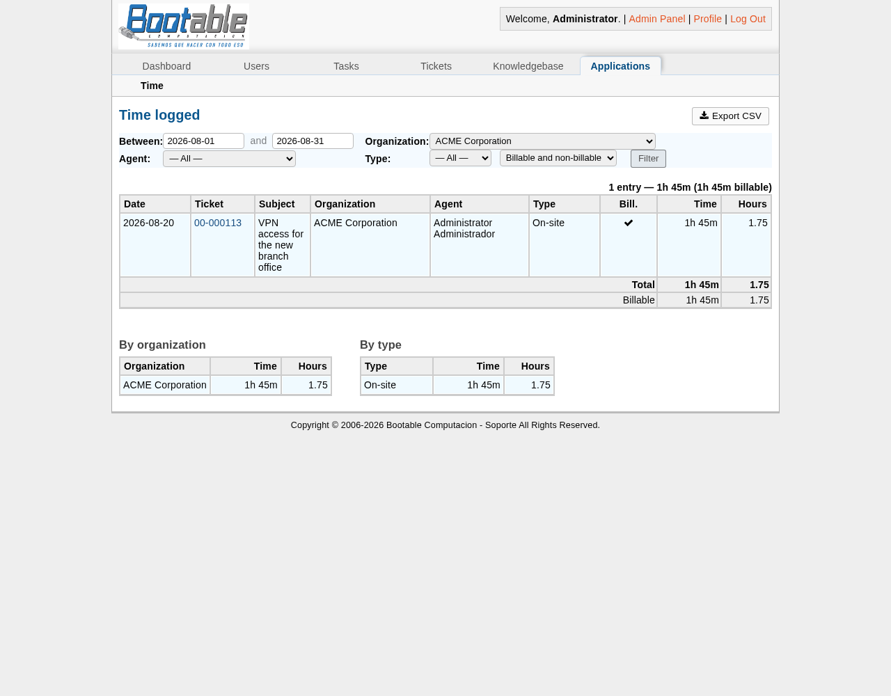

# osTicket Time Tracking

Registrá el tiempo dedicado a cada respuesta y nota interna, con tipo de tiempo
y marca de facturable. Miralo en pantalla, exportalo a CSV, consultalo por API
REST.

Hecho para **osTicket 1.18.x**. Probado en 1.18.4 con PHP 8.2 y MariaDB 11.8.

*In English: [README.md](README.md)*



## Por qué otro

La propuesta histórica del upstream para esta funcionalidad ([PR #3231]) son
1.370 líneas de parches sobre 24 archivos del core, está abierta desde 2016 y
nunca se mergeó. Parchear el core significa reaplicar esos cambios después de
cada upgrade, y perder el registro de horas en silencio el día que te olvidás.

Este plugin hace lo contrario: **no toca el core** y los datos viven en una
tabla propia, así ningún upgrade de osTicket puede romperlos ni borrarlos. Todo
se engancha a los signals públicos de plugins.

[PR #3231]: https://github.com/osTicket/osTicket/pull/3231

## Qué hace

- Un **campo de tiempo** en los formularios de respuesta y nota interna: acepta
  `90`, `1:30`, `1h30`, `2h`, `1,5h` o `45m`, lo que al agente le salga natural.
- **Tipos de tiempo** (Remoto, On-site, Viaje, Taller — configurables) y casilla
  de **facturable**.
- **Redondeo** opcional (5/15/30/60 minutos, hacia arriba) y **tiempo
  obligatorio**.
- Un **badge en cada entrada del hilo** y el **total en la ficha del ticket**.
- Un **reporte** con filtros por período, organización, agente, tipo y
  facturable, con desgloses por organización y por tipo.
- **Exportación a CSV** con BOM UTF-8 y punto y coma, para que Excel en español
  lo abra bien.
- **Endpoints REST** para llevar los números a la facturación.
- Una **columna de cola** opcional con el tiempo registrado por ticket.

## Instalación

```bash
unzip osticket-timetrack-1.0.0.zip
cd osticket-timetrack
sudo ./install.sh /var/www/osticket
```

Después, en el panel de administración:

1. **Admin Panel → Manage → Plugins → Add New Plugin → Time Tracking**
2. Instalarlo, abrirlo y **agregar una instancia** — eso es lo que realmente
   activa un plugin en osTicket 1.17 en adelante.
3. Opcional: **Manage → Ticket Queues → *tu cola* → Columns** y agregar la
   anotación *Tiempo registrado*.

La tabla `ost_timetrack` se crea sola la primera vez que arranca el plugin. No
se toca nada más de tu base.

El instalador también deja **`scp/apps.php`**. Ese archivo no es un capricho
nuestro: osTicket arma la pestaña "Applications" apuntando ahí
(`include/class.nav.php`) pero nunca lo distribuye, así que el tab da 404 para
*cualquier* plugin que registre una aplicación. Es un archivo nuevo, no lo pisa
ningún upgrade.

## Configuración

| Opción | Qué hace |
|---|---|
| Registrar tiempos | Agrega el campo a los formularios. Apagarlo deja de registrar sin borrar nada |
| Tipos de tiempo | Uno por línea; el primero es el que viene por defecto |
| Facturable por defecto | Deja tildada la casilla de facturable |
| Tiempo obligatorio | Rechaza respuestas y notas sin tiempo |
| Redondeo | Redondea hacia arriba a 5, 15, 30 o 60 minutos |
| Permitir facturar notas internas | Apagado por defecto: las notas se registran pero nunca se facturan |
| Reportes solo para administradores | Encendido por defecto |

## API REST

Usa las API keys del propio osTicket (`X-API-Key`). No necesita ningún parche
del core.

```bash
# Todo lo registrado en un ticket
curl -H "X-API-Key: $KEY" https://helpdesk.example.com/api/timetrack/ticket/47.json

# Un período, filtrando por organización, agente, tipo o facturable
curl -H "X-API-Key: $KEY" \
  'https://helpdesk.example.com/api/timetrack/report.json?from=2026-08-01&to=2026-08-31&billable=1'

# Lo mismo en CSV
curl -H "X-API-Key: $KEY" \
  'https://helpdesk.example.com/api/timetrack/report.csv?from=2026-08-01&to=2026-08-31'
```

También se puede mandar el tiempo al crear un ticket por API:

```json
{"name": "...", "email": "...", "subject": "...", "message": "...",
 "tt_minutes": "1:30", "tt_type": "Remoto", "tt_billable": 1}
```

## Parche opcional del core

El reporte y el CSV del plugin funcionan sin tocar nada. Si además querés que
la **exportación nativa de la cola** (el link "Export" del listado de tickets)
incluya las columnas de tiempo, hay un parche de 7 líneas:

```bash
sudo ./core-patch/apply.sh /var/www/osticket           # aplicar
sudo ./core-patch/apply.sh --check /var/www/osticket
sudo ./core-patch/apply.sh --revert /var/www/osticket
```

**Hay que reaplicarlo después de cada upgrade de osTicket.** Es lo único de lo
que el plugin no te puede proteger, y justamente por eso es opcional y son
siete líneas.

## nginx

En Apache funciona sin cambiar nada. En nginx hay que asegurarse de que PHP
reciba `PATH_INFO`: el reporte se sirve como `/scp/apps.php/timetrack/` y la
API como `/api/<endpoint>`. Si la API devuelve `URL not supported` con 400, o
el reporte sale en blanco, el vhost lo está descartando. Ver
[docs/nginx.md](docs/nginx.md).

## Traducciones

Inglés por defecto, castellano rioplatense incluido. Para agregar un idioma,
copiá `plugin/i18n/es_AR.php`, renombralo a tu locale y traducí los valores. No
hay nada que compilar: el plugin lee el idioma del agente y toma el archivo
solo. Los pull requests con locales nuevos son bienvenidos.

## Desinstalación

```bash
sudo ./uninstall.sh /var/www/osticket
```

Borra los archivos del plugin y revierte el parche opcional. **Los registros de
tiempo quedan donde están**: la tabla `ost_timetrack` se borra a mano, a
propósito, para que nadie pierda el historial de facturación por un descuido.

## Notas sobre las tripas de osTicket

Cosas que costaron tiempo de averiguar y conviene saber antes de meter mano acá:

- `Application::registerStaffApp()` **no** es static aunque escriba en una
  propiedad estática. Llamarlo estáticamente es fatal en PHP 8 y se lleva
  puesto el help desk entero, no sólo el plugin.
- `scp/apps/dispatcher.php` se niega a atender pedidos directos; hay que
  incluirlo.
- Todo link de descarga dentro del panel necesita `class="no-pjax"`, o pjax lo
  pide por XHR e inyecta el archivo dentro de la página.
- `header.inc.php` espera `$cfg`, `$ost`, `$thisstaff`, `$nav`, `$title`,
  `$errors`, `$msg` y `$warn` como globales; incluirlo desde adentro de un
  método sin declararlas muere con `getAllowIframes() on null`.
- El datepicker del core usa una ruta **relativa** en `buttonImage`, que da 404
  en cualquier URL con path info. Este plugin inicializa el suyo.
- `QuerySet::one()` tira `DoesNotExist` cuando el resultado viene vacío, así
  que no sirve para totales que legítimamente pueden dar cero.
- El ORM descubre las columnas inspeccionando la tabla, pero lo cachea 30
  minutos en APCu: reiniciá PHP-FPM después de cambiar el esquema.

## Licencia

GNU General Public License v2, la misma que osTicket. Ver [LICENSE](LICENSE).
