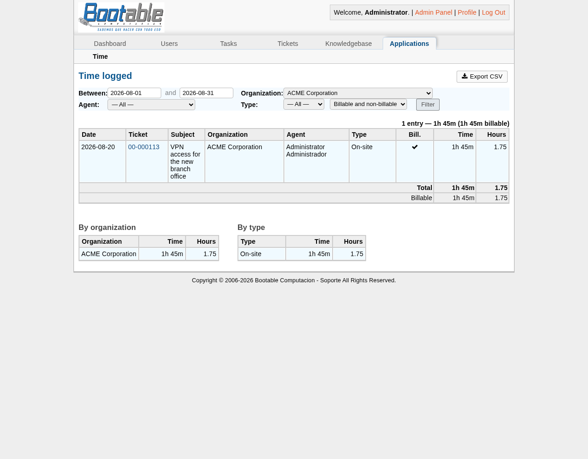

# osTicket Time Tracking

Log the time spent on every reply and internal note, with a time type and a
billable flag. Report it on screen, export it as CSV, query it over the REST
API.

Built for **osTicket 1.18.x**. Tested on 1.18.4 with PHP 8.2 and MariaDB 11.8.

*En español: [LEEME.md](LEEME.md)*



## Why another one

The long-standing upstream proposal for this feature ([PR #3231]) is 1,370
lines of patches across 24 core files, has been open since 2016 and was never
merged. Patching the core means re-applying those changes after every upgrade,
and silently losing your billing records when you forget.

This plugin takes the opposite approach: **the core is untouched** and the data
lives in its own table, so an osTicket upgrade cannot break or erase it.
Everything hooks into public plugin signals.

[PR #3231]: https://github.com/osTicket/osTicket/pull/3231

## What you get

- A **time field** in the reply and internal note forms — type `90`, `1:30`,
  `1h30`, `2h`, `1,5h` or `45m`, whatever the agent finds natural.
- **Time types** (Remote, On-site, Travel, Workshop — configurable) and a
  **billable** checkbox.
- Optional **rounding** (5/15/30/60 minutes, up) and **mandatory time**.
- A **badge on every thread entry** and a **total on the ticket summary**.
- A **report** with filters by date range, organization, agent, type and
  billable status, with per-organization and per-type breakdowns.
- **CSV export** with a UTF-8 BOM and semicolon separators, so it opens
  correctly in Excel outside the US locale.
- **REST endpoints** to pull the numbers into your invoicing.
- An optional **queue column** showing the time logged per ticket.

## Install

```bash
unzip osticket-timetrack-1.0.0.zip
cd osticket-timetrack
sudo ./install.sh /var/www/osticket
```

Then, in the admin panel:

1. **Admin Panel → Manage → Plugins → Add New Plugin → Time Tracking**
2. Install it, open it and **add an instance** — that is what actually enables
   a plugin in osTicket 1.17+.
3. Optional: **Manage → Ticket Queues → *your queue* → Columns** and add the
   *Time logged* annotation.

The `ost_timetrack` table is created automatically the first time the plugin
boots. Nothing else touches your database.

The installer also drops in **`scp/apps.php`**. That file is not ours by
choice: osTicket builds the "Applications" tab pointing at it
(`include/class.nav.php`) but never ships it, so the tab 404s for *any* plugin
that registers a staff app. It is a new file, so no upgrade overwrites it.

## Configuration

| Setting | What it does |
|---|---|
| Track time | Adds the field to the forms. Turn off to stop logging without losing data |
| Time types | One per line; the first is the default |
| Billable by default | Pre-ticks the billable box |
| Time is required | Rejects replies and notes without time |
| Rounding | Rounds up to 5, 15, 30 or 60 minutes |
| Allow billing internal notes | Off by default: notes are logged but never billable |
| Reports for admins only | On by default |

## REST API

Uses osTicket's own API keys (`X-API-Key`). No core patch required.

```bash
# Everything logged on one ticket
curl -H "X-API-Key: $KEY" https://helpdesk.example.com/api/timetrack/ticket/47.json

# A period, optionally filtered by organization, agent, type or billable
curl -H "X-API-Key: $KEY" \
  'https://helpdesk.example.com/api/timetrack/report.json?from=2026-08-01&to=2026-08-31&billable=1'

# Same thing as a CSV
curl -H "X-API-Key: $KEY" \
  'https://helpdesk.example.com/api/timetrack/report.csv?from=2026-08-01&to=2026-08-31'
```

Time can also be sent when creating a ticket through the API:

```json
{"name": "...", "email": "...", "subject": "...", "message": "...",
 "tt_minutes": "1:30", "tt_type": "Remote", "tt_billable": 1}
```

## Optional core patch

The plugin's own report and CSV work out of the box. If you also want the
**built-in queue export** (the "Export" link under a ticket listing) to carry
the time columns, there is a 7-line patch:

```bash
sudo ./core-patch/apply.sh /var/www/osticket        # apply
sudo ./core-patch/apply.sh --check /var/www/osticket
sudo ./core-patch/apply.sh --revert /var/www/osticket
```

**Re-run it after every osTicket upgrade.** This is the one thing the plugin
cannot protect you from, which is exactly why it is optional and kept to seven
lines.

## nginx

On Apache this works with no changes. On nginx, make sure PHP receives
`PATH_INFO` — the report is served as `/scp/apps.php/timetrack/` and the API as
`/api/<endpoint>`. A `URL not supported` 400 from the API, or a blank report
page, means the vhost is dropping it. See [docs/nginx.md](docs/nginx.md).

## Translations

English by default, Spanish (Argentina) included. To add a language, copy
`plugin/i18n/es_AR.php`, rename it to your locale and translate the values.
There is nothing to compile: the plugin reads the agent's language setting and
picks the file up. Pull requests with new locales are welcome.

## Uninstall

```bash
sudo ./uninstall.sh /var/www/osticket
```

Removes the plugin files and reverts the optional patch. **Your time entries
are left alone** — the `ost_timetrack` table has to be dropped by hand, on
purpose, so nobody loses billing history to a typo.

## Notes on osTicket internals

Things that cost time to find out and are worth knowing before you hack on
this:

- `Application::registerStaffApp()` is **not** static even though it writes to
  a static property. Calling it statically is fatal on PHP 8 and takes the
  whole help desk down, not just the plugin.
- `scp/apps/dispatcher.php` refuses direct requests; it has to be included.
- Any download link inside the staff panel needs `class="no-pjax"`, or pjax
  fetches it over XHR and injects the file into the page.
- `header.inc.php` expects `$cfg`, `$ost`, `$thisstaff`, `$nav`, `$title`,
  `$errors`, `$msg` and `$warn` as globals; including it from inside a method
  without declaring them dies on `getAllowIframes() on null`.
- The core datepicker uses a **relative** `buttonImage` path, which 404s on any
  URL with path info. This plugin initialises its own.
- `QuerySet::one()` throws `DoesNotExist` on an empty result, so it is useless
  for totals that can legitimately be zero.
- The ORM discovers columns by inspecting the table, but caches that in APCu
  for 30 minutes — restart PHP-FPM after schema changes.

## Licence

GNU General Public License v2, the same as osTicket. See [LICENSE](LICENSE).
